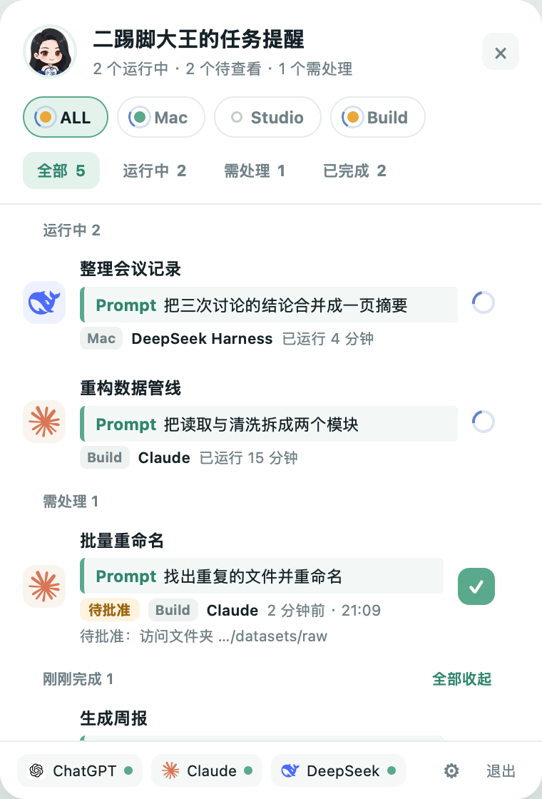

# 二踢脚大王

<p align="center">
  
  
</p>

二踢脚大王是一款 macOS 桌面宠物，用来跟踪 AI 编程助手的任务进度。它读取本机和远程服务器上的会话记录，
在桌面上提示哪些任务在运行、哪些需要你处理、哪些已经完成。

## 功能

- **多个助手集中查看**：本机支持 ChatGPT（Codex）、Claude 桌面版、DeepSeek Harness；
  通过 SSH 还可查看服务器上的 Codex 和 Claude Code。
- **状态提醒**：运行中、需处理（待批准、待回答、待确认、出错）、已完成分开显示；
  桌宠角标显示待查看的数量，有需要处理的任务时变为红色。
- **显示提问内容**：每个任务显示你的提问摘要、中途追加的提问和回复摘要。
- **按机器筛选**：可查看全部机器，或只看本机、某一台服务器。
- **只读**：不向 AI 应用发送任何指令，不修改它们的数据。

## 系统要求

- macOS 13 或更高版本，Apple Silicon（M1 及以后）
- 远程服务器（可选）：可通过 SSH 密钥免密登录，并安装 Python 3.8 或更高版本

## 安装

1. 在 Releases 页面下载最新的 `ErTiJiaoDaWang-<版本>-macOS-arm64.zip` 并解压。
2. 将 `二踢脚大王.app` 拖到“应用程序”文件夹。
3. 首次打开前，在“终端”中运行：

   ```sh
   xattr -dr com.apple.quarantine /Applications/二踢脚大王.app
   ```

   本应用未经过 Apple 公证，此命令用于解除系统的下载隔离。也可以先打开一次，
   在“系统设置 → 隐私与安全性”中点击“仍要打开”。
4. 打开应用。桌宠出现在屏幕右下角，菜单栏同时出现应用图标。

如需开机启动：系统设置 → 通用 → 登录项，添加“二踢脚大王”。

## 使用

- **任务面板**：单击桌宠打开。顶部选择机器，下方分为“全部 / 运行中 / 需处理 / 已完成”。
- **打开任务**：单击本机任务会打开对应应用（ChatGPT 任务会定位到所在会话）；
  单击服务器任务会在“终端”中连接到该服务器，不会执行任何命令。
- **收起任务**：点击任务右侧的 ✓，或在“已完成”中点击“全部收起”。
  在同一个对话中继续提问时，上一轮的结果会自动收起。
- **移动与缩放**：拖动桌宠可移动位置；右键菜单可调整大小（小 / 中 / 大 / 特大），
  按住 ⌥ 键滚动滚轮可微调。
- **菜单栏**：打开任务面板、将桌宠放回右下角、调整大小、查看服务器连接状态、退出。

## 设置

单击任务面板右下角的 ⚙ 打开设置，保存后立即生效。

**本机记录位置**：默认读取以下位置，记录存放在其他目录时再填写完整路径。

| 应用 | 默认位置 |
| --- | --- |
| ChatGPT（Codex） | `~/.codex` |
| Claude 桌面版 | `~/Library/Application Support/Claude` |
| DeepSeek Harness | `~/.dsh/sessions` |

**服务器**：打开“启用 SSH 远程采集”，然后为每台服务器填写：

- **HOST**：`ssh` 命令使用的主机名，例如 `~/.ssh/config` 中的 Host 名或 `user@地址`
- **显示名**：面板中显示的名称，可留空

添加前请先在“终端”中确认能免密连接：

```sh
ssh -o BatchMode=yes <HOST> 'echo ok'
```

输出 `ok` 即可使用。需要输入密码的服务器无法读取，请先配置 SSH 密钥登录。
应用读取服务器上 `~/.codex/sessions`、`~/.claude/projects`、`~/.claude/sessions` 中的记录。

## 隐私与权限

- 只读取各应用自身保存的会话记录，不读取 `auth.json`、`.claude.json` 等凭据文件。
- 使用你现有的 SSH 配置和密钥，不保存密码，不修改 `~/.ssh` 中的任何文件。
- 服务器上不写入任何文件，只返回任务标题、提问摘要（敏感内容已脱敏）、状态和时间。
- 不需要完全磁盘访问、辅助功能或屏幕录制权限。
- 所有数据保存在本机，不上传到任何服务。

## 注意事项

- 已完成的任务保留 24 小时；首次启动前已结束的任务不会显示。
- 任务超过 30 分钟没有新记录时，会显示为“待确认”。
- 服务器任务大约每 10 秒更新一次；网络中断期间显示最后一次读取的结果，并标注离线。
- Claude 仅支持保存在本机的任务，网页端的普通对话不在显示范围内。

## 卸载

退出应用后，删除以下内容：

- `/Applications/二踢脚大王.app`
- `~/Library/Application Support/二踢脚大王/`（设置与任务状态）

## 从源码构建

需要 Xcode 命令行工具，以及位于 `runtime/python` 的 Python 3.12（可运行 `python3 scripts/fetch_deps.py` 下载）。
运行 `./构建发布版.command`，构建结果位于 `dist/`。

## 致谢

- [DeepSeek](https://www.deepseek.com) 与 [Claude](https://claude.com)：本项目在它们的协助下设计、编写和测试。
- [python-build-standalone](https://github.com/astral-sh/python-build-standalone)：应用内置的 Python 运行时。
- [python-zstandard](https://github.com/indygreg/python-zstandard)：用于读取 DeepSeek Harness 的压缩会话记录。
- ChatGPT、Claude、DeepSeek 的名称与图标归各自所有者所有，本应用仅用于标识对应的应用。
